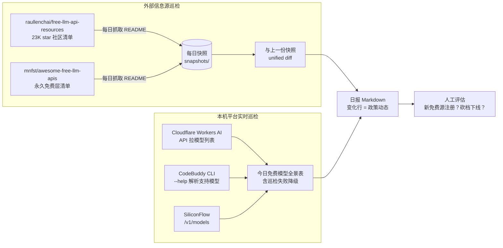

# 免费算力雷达 Free Compute Radar

> 每天自动回答一个问题：**今天还有哪些 LLM 免费额度 / 免费算力端口能用？哪些昨天还好好的、今天就没了？**
>
> English: A zero-dependency Python script that daily tracks changes in free-tier LLM APIs — snapshots community-maintained free-API lists, diffs them against yesterday, and probes your own registered platforms for a live model panorama. One Markdown report per day.

## 为什么需要它

2026 年各家 LLM 免费政策收紧得飞快，靠人肉记忆或一次性整理的清单必然过期：

- Gemini CLI 免费层被 Google 砍停（2026-06 停服）
- Qwen Code 免费档取消，改为订阅制
- SiliconFlow 标着「免费」的模型实际要求账户正余额（错误码 30001）
- 智谱 GLM 永久免费档限流严，但资源包活动常在变

**免费清单的半衰期以「天」计**。本工具把「每天核对一遍各家免费政策动态 + 巡检自己手上已接入的端口」这件事自动化，产出一份日报，变化行即各家免费政策动态。

## 工作原理

两条信息流，汇成一份日报：



- **外部信息流**回答「市面上免费清单变了什么」——社区清单（数千 star、每日自动更新）本身就是聚合器，抓它的 diff 等于免费获得全网免费 API 动态。
- **本机信息流**回答「我自己已注册的端口今天实际能用的模型有哪些」——清单说有不算数，能拉到自己账号的模型列表才算数。巡检失败也会如实写进日报（如 CLI 不在 PATH、key 失效），**宁可报失败也不静默跳过**。
- **人工闭环**：日报只有信息没有决策。变化行由人评估后决定是否注册新平台 / 调整调度策略。

## 日报长什么样

见 [docs/日报样例.md](docs/日报样例.md)。核心两段：

```markdown
## free-llm-api-resources（raullenchai 免费LLM API大全）
- ⚠️ 有变化：12 行增删（对照 2026-11-05.md）
- 新增要点：
  - - **Groq** — 免费档 llama-4-scout，30 RPM …
- 移除要点：
  - - ~~Cerebras 免费 1M tokens/天~~

## 今日免费模型全景表（本机已接入平台实时巡检）
### Cloudflare Workers AI（免费 10K neurons/天）
- @cf/meta/llama-3.3-70b-instruct-fp8-fast
- @cf/zai-org/glm-5.3-flash
  …
```

## 快速开始

零第三方依赖，纯 Python 标准库（3.8+）。

```bash
git clone https://github.com/huanghuninbox/free-token-radar-cn.git
cd free-compute-radar
cp .env.example .env   # 按需填 key；全空也能跑（跳过对应平台巡检）
python radar.py        # 或 py -3 radar.py
```

首次运行：抓取两份社区清单存快照、巡检本机平台、日报落 `reports/`。
第二次运行起：自动与上一份快照 diff，变化行写入日报。

### 定时运行

Windows（任务计划程序，每日 09:00）：

```powershell
$action  = New-ScheduledTaskAction -Execute 'py -3' -Argument 'radar.py' -WorkingDirectory 'C:\tools\free-compute-radar'
$trigger = New-ScheduledTaskTrigger -Daily -At 09:00
Register-ScheduledTask -TaskName 'FreeComputeRadar' -Action $action -Trigger $trigger
```

Linux / macOS（crontab）：

```cron
0 9 * * * cd /path/to/free-compute-radar && python3 radar.py >> radar_run.log 2>&1
```

> 诊断提示：定时任务「没反应」时先查退出码与日志（Windows 用 `Get-ScheduledTaskInfo` 看 `LastTaskResult`），不要凭表象猜。本工具自己也曾因一次代码改动的语法错误在清晨静默失败过——日志里一行 `SyntaxError` 三秒定位。

## 配置

全部通过环境变量（或 `.env` 文件，脚本会读同目录 `.env`）：

| 变量 | 默认 | 说明 |
|---|---|---|
| `REPORT_DIR` | `./reports` | 日报输出目录 |
| `SNAPSHOT_DIR` | `./snapshots` | 快照存储目录 |
| `PROXY` | 空（直连） | HTTP 代理，如 `http://127.0.0.1:10809`；取不到源时自动回退直连 |
| `SECRETS_FILE` | `~/.free-compute-radar/secrets.env` | 平台 key 文件（KEY=VALUE 格式） |
| `CF_API_TOKEN` / `CF_ACCOUNT_ID` | — | Cloudflare Workers AI 巡检（需 `AI` 权限 Token） |
| `SILICONFLOW_KEY` | — | SiliconFlow 模型列表巡检 |
| `GLMFREE_KEY` | — | 智谱开放平台 key（保留扩展位） |

**key 可以放 `SECRETS_FILE` 或环境变量，但永远不要提交进仓库**（`.gitignore` 已兜底）。Cloudflare 的免费 10K neurons/天与 Token 创建见[官方文档](https://developers.cloudflare.com/workers-ai/)。

## 自定义扩展

### 加一个外部信息源

`radar.py` 顶部的 `SOURCES` 追加一项即可（任何可 GET 的纯文本 URL，按行 diff）：

```python
SOURCES.append({'id': 'my-source', 'desc': '某厂商免费层公告页',
                'url': 'https://example.com/free-tier.md'})
```

厂商状态页、公告页（HTML）也可以加——fetch 会按纯文本处理，diff 噪音略大但趋势可读。

### 加一个本机平台巡检

`local_models.py` 里仿照现有函数写一个 `xxx_models()`，返回 `(平台说明, 模型名列表)`，加进 `all_platforms()` 的注册表。约定：

- 返回的是**能实际调用的模型清单**（从自己账号的 API/CLI 拉，不抄官网宣传页）
- 限额说明写进平台说明字符串（如「免费 10K neurons/天」）
- 失败让异常抛出去——外层会把失败原因写进日报，不吞错

## 实测坑与教训（2026-11，持续更新）

这是本项目最有价值的部分之一：**宣传页说的和实际能用的，差距很大**。

| 平台 | 宣传 | 实测（2026-11） |
|---|---|---|
| Cloudflare Workers AI | 免费 10K neurons/天 | ✅ 属实，官方 API 拉模型列表即可巡检 |
| 智谱 GLM `glm-4.7-flash` | 永久免费档 | ⚠️ 属实但限流严（约 1-3 次/分，连续两发即 429），仅适合低频任务；实名/邀请可攒赠送资源包 |
| CodeBuddy CLI | 与 IDE 共用积分池 | ✅ 无头模式 `codebuddy -p` 可用，月度积分池签到续命 |
| SiliconFlow | 模型页标「免费」 | ⚠️ 实测免费模型也要求账户正余额（30001 余额不足） |
| Gemini CLI | 免费层 1000 请求/天 | ❌ 已砍停（2026-06 停服），替代品 preview 档仅 20-50 请求/天 |
| Qwen Code CLI | 免费 OAuth 档 | ❌ 已取消，改订阅制 |
| 各类逆向「free-api」项目 | 白嫖官方接口 | ❌ 不建议：违反条款 + 封号风险，官方 API 本就白菜价 |

结论：**外部免费 CLI/额度政策一年内连续收紧，任何免费清单都要每天核对，且不能作为关键业务的算力支柱**——这正是本工具存在的理由。

## FAQ

**Q: 日报说「无变化」，可信吗？**
可信但有两个盲区：① 社区清单没覆盖的厂商政策变化抓不到；② 本机巡检只验证「模型列表可达」，不逐个试调（避免消耗额度）。要更实可在巡检函数里加一个 1-token 的真实调用探活。

**Q: 抓取失败怎么办？**
先代理后直连各试一次，都失败则当天日报不生成、进程退出码非 0——让定时任务系统的失败告警（如有）接得住。网络恢复后下次运行自动补上快照链（diff 永远对照「最近一份成功快照」）。

**Q: 会把我的 key 传到哪里吗？**
不会。key 只用于向对应平台官方 API 发请求；仓库代码零硬编码 key，`.gitignore` 拦住 `.env` 与 secrets 文件。

**Q: 为什么不做成网页服务 / 推送到手机？**
刻意保持「一个脚本 + 一份日报」的最小形态：接入你已有的通知渠道（邮件/企微/Telegram bot 各一行代码的事）比内置更好维护。欢迎 PR。

## 与本地部署版的关系

本仓库是「免费算力雷达」的**开源发布镜像**（脱敏参数化：代理/输出目录/快照目录/密钥文件全部走环境变量）。同一套雷达另有一个**本地部署版**作为日常运行实体——由部署方的 Windows 计划任务每日定时驱动，输出目录与密钥路径硬编码指向部署方内部位置，伴生部署方的本地算力管理脚本，不随本仓库发布。

两者分工：**本仓库＝对外发布与文档事实源**（改动经同步机制自动上线）；**本地部署版＝在役运行**（本地改动应回流本仓库）。功能面两者一致（相同的信息源、相同的平台巡检、相同的日报格式）；配置方式不同——本仓库零硬编码、key 可全空跑通（对应平台降级报因），本地版按部署方环境预置。部署到自己的机器时，以本仓库快速开始为准即可。

## License

[MIT](LICENSE)
